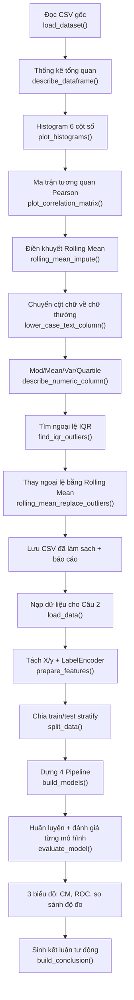

# Bài kiểm tra thực hành cuối kỳ — Làm sạch dữ liệu & Phân loại

Bộ dữ liệu: [`Maternal Health Risk Data Set - Modi.csv`](../data-cleaning-ml/test/Maternal%20Health%20Risk%20Data%20Set%20-%20Modi.csv)

## Mục lục

- [Cấu trúc thư mục](#cấu-trúc-thư-mục) · [Cách chạy](#cách-chạy)
- **[PHẦN A — Chú thích chi tiết từng hàm trong code](#phần-a--chú-thích-chi-tiết-từng-hàm-trong-code)**
  - [A.1 — `cau1_lam_sach_du_lieu.py`](#a1--cau1_lam_sach_du_lieupy)
  - [A.2 — `cau2_phan_loai_4_mo_hinh.py`](#a2--cau2_phan_loai_4_mo_hinhpy)
  - [A.3 — `chay_toan_bo.py`](#a3--chay_toan_bopy)
  - [A.4 — Sơ đồ luồng xử lý](#a4--sơ-đồ-luồng-xử-lý)
- [PHẦN B — Kết quả và phân tích](#phần-b--kết-quả-và-phân-tích)
  - [Câu 1 — Trực quan và làm sạch](#câu-1--trực-quan-và-làm-sạch-dữ-liệu)
  - [Câu 2 — Phân loại 4 mô hình](#câu-2--phân-loại-với-4-mô-hình)
- [Ghi chú kỹ thuật](#ghi-chú-kỹ-thuật)

## Cấu trúc thư mục

```
bai-kiem-tra-cuoi-ky/
├── cau1_lam_sach_du_lieu.py        # Câu 1: trực quan + làm sạch dữ liệu
├── cau2_phan_loai_4_mo_hinh.py      # Câu 2: phân loại với 4 mô hình
├── chay_toan_bo.py                 # Chạy tuần tự cả Câu 1 và Câu 2
├── README.md                       # File này — chú thích từng hàm + phân tích kết quả
└── output/                         # Toàn bộ kết quả sinh ra
    ├── cau1_histogram_6_cot_so.png
    ├── cau1_ma_tran_tuong_quan.png
    ├── cau1_truoc_sau_xu_ly_ngoai_le.png
    ├── cau1_bao_cao_lam_sach.txt
    ├── Maternal_Health_Risk_cleaned.csv
    ├── cau2_confusion_matrix_4_mo_hinh.png
    ├── cau2_duong_roc_4_mo_hinh.png
    ├── cau2_so_sanh_do_do_4_mo_hinh.png
    ├── cau2_bang_tong_hop_hieu_suat.csv
    └── cau2_ket_luan.txt
```

## Cách chạy

Dùng virtual environment sẵn có trong `data-cleaning-ml/.venv`:

```powershell
# Chạy cả hai câu
.\data-cleaning-ml\.venv\Scripts\python.exe bai-kiem-tra-cuoi-ky\chay_toan_bo.py

# Hoặc chạy từng câu
.\data-cleaning-ml\.venv\Scripts\python.exe bai-kiem-tra-cuoi-ky\cau1_lam_sach_du_lieu.py
.\data-cleaning-ml\.venv\Scripts\python.exe bai-kiem-tra-cuoi-ky\cau2_phan_loai_4_mo_hinh.py
```

> Cần cài thêm `matplotlib` và `seaborn` cho phần trực quan:
> `.\data-cleaning-ml\.venv\Scripts\python.exe -m pip install matplotlib seaborn`

---

# PHẦN A — CHÚ THÍCH CHI TIẾT TỪNG HÀM TRONG CODE

Phần này giải thích **từng hàm** trong 3 script: hàm dùng để làm gì, tham số
vào/ra, và vì sao cần dùng nó.

---

## A.1 — `cau1_lam_sach_du_lieu.py`

### Nhóm 1: Hằng số cấu hình (phần đầu file)

| Tên | Giá trị | Ý nghĩa |
|-----|---------|----------|
| `BASE_DIR` | thư mục chứa script | Gốc để dựng đường dẫn tương đối, không phụ thuộc vị trí gọi script |
| `WORKSPACE_DIR` | `BASE_DIR.parent` | Thư mục gốc workspace (nơi có `data-cleaning-ml/`) |
| `CSV_PATH` | đường dẫn file CSV gốc | Nơi đọc dữ liệu nguồn |
| `OUTPUT_DIR` | `BASE_DIR/output` | Nơi lưu ảnh biểu đồ, CSV đã làm sạch, báo cáo |
| `ROLLING_WINDOW` | `3` | Kích thước cửa sổ rolling: tối đa 3 dòng đã quan sát trước ô đang trống |
| `STAT_COLUMN` | `"HeartRate"` | Cột số dùng để tính Mod/Mean/Var/Quartile và xử lý ngoại lệ |
| `TEXT_COLUMN` | `"RiskLevel"` | Cột kiểu Text dùng để minh hoạ chuyển sang chữ thường |
| `DEMONSTRATE_ROLLING` | `True` | Bật/tắt phần minh hoạ Rolling Mean trên bản sao dữ liệu |

### Nhóm 2: Hàm nạp và mô tả dữ liệu

#### `load_dataset(path: Path) -> pd.DataFrame`

| | |
|---|---|
| **Vai trò** | Đọc file CSV gốc và trả về DataFrame thô, chưa làm sạch gì |
| **Tham số** | `path`: đường dẫn tới file CSV cần đọc |
| **Trả về** | `pd.DataFrame` chứa toàn bộ dữ liệu |
| **Cách làm** | `pd.read_csv(path, encoding="utf-8-sig")` — dùng `utf-8-sig` vì file có **BOM** UTF-8, nếu dùng `utf-8` thì tên cột đầu tiên sẽ thành `Age` (lỗi khó phát hiện). Sau đó `.strip()` tên cột để loại khoảng trắng thừa. In ra số dòng, số cột và kiểu dữ liệu từng cột. |

#### `describe_dataframe(frame: pd.DataFrame) -> None`

| | |
|---|---|
| **Vai trò** | In bảng tổng quan về dữ liệu thô trước khi làm sạch |
| **Tham số** | `frame`: DataFrame cần mô tả |
| **Trả về** | `None` — hàm chỉ in ra console |
| **Cách làm** | Gom 3 thông tin mỗi cột vào một bảng: số ô trống (`isna().sum()`), số giá trị khác nhau (`nunique()`), kiểu dữ liệu (`dtypes`). In tổng số ô trống của cả bảng. Giúp phát hiện nhanh cột nào cần điền khuyết. |

#### `describe_numeric_column(values: pd.Series) -> dict`

| | |
|---|---|
| **Vai trò** | Tính toàn bộ thống kê mô tả của **một cột số**: Mod, Mean, Var, Quartile và các số liệu phụ |
| **Tham số** | `values`: Series chứa giá trị của cột số cần thống kê |
| **Trả về** | `dict` chứa các khóa: `column`, `count`, `mode`, `mode_frequency`, `mean`, `variance`, `std`, `min`, `q1`, `median`, `q3`, `max`, `iqr` |
| **Cách làm** | `pd.to_numeric(..., errors="coerce").dropna()` để loại giá trị không phải số. **Mode**: dùng `value_counts()` rồi lấy **tất cả** giá trị có tần suất cao nhất (tránh trường hợp nhiều mode bị bỏ sót) — ở đây mode = `[70]`. **Var**: `observed.var(ddof=1)` là **phương sai mẫu** (chia cho $n-1$), đúng quy ước thống kê mô tả. **Quartile**: `quantile(0.25)` = Q1, `quantile(0.50)` = Q2 (median), `quantile(0.75)` = Q3; `iqr` = Q3 − Q1. |

#### `print_descriptive_stats(stats: dict) -> None`

| | |
|---|---|
| **Vai trò** | In kết quả thống kê mô tả ra console dưới dạng bảng dễ đọc |
| **Tham số** | `stats`: dict trả về từ `describe_numeric_column()` |
| **Trả về** | `None` |
| **Cách làm** | Chỉ định dạng và in ra console. Hàm này tách riêng khỏi hàm tính toán để phần **tính toán** và phần **hiển thị** tách bạch — muốn đổi cách hiển thị (ví dụ xuất ra DOCX) chỉ cần sửa hàm này. |

### Nhóm 3: Hàm phát hiện và xử lý ngoại lệ

#### `find_iqr_outliers(values: pd.Series) -> tuple[float, float, pd.Series]`

| | |
|---|---|
| **Vai trò** | Tìm ngoại lệ bằng thuật toán **IQR** (Interquartile Range) |
| **Tham số** | `values`: Series của cột số |
| **Trả về** | Bộ 3: `(lower, upper, outliers)` — hai ngưỡng và Series chứa các giá trị ngoại lệ (**giữ nguyên index** để truy ngược được dòng gốc) |
| **Công thức** | $\text{lower} = Q_1 - 1.5 \times \text{IQR}$, $\text{upper} = Q_3 + 1.5 \times \text{IQR}$ |
| **Cách làm** | Tính Q1, Q3, IQR rồi tạo mask `(values < lower) | (values > upper)`. Hàm này **chỉ đánh dấu, không xoá hay sửa** dữ liệu — đúng yêu cầu "TUYỆT ĐỐI KHÔNG XÓA" trong đề. |

#### `rolling_mean_impute(values, window=3, fallback=None) -> tuple[pd.Series, int, int]`

| | |
|---|---|
| **Vai trò** | **Thay thế giá trị trống/NaN** bằng kỹ thuật **Rolling Mean** (yêu cầu 3.1 của đề) |
| **Tham số** | `values`: Series cần điền · `window`: kích thước cửa sổ (mặc định 3) · `fallback`: giá trị dùng khi chưa có lịch sử quan sát |
| **Trả về** | Bộ 3: `(series_đã_điền, số_ô_điền_bằng_window, số_ô_dùng_fallback)` |
| **Nguyên tắc cốt lõi** | ① Chỉ dùng tối đa `window` giá trị **đã quan sát** trước ô đang trống, đồng thời **loại bỏ chính các ô đang trống** khỏi lịch sử ② **Không** dùng giá trị tương lai ③ **Không** dùng giá trị đã điền trước đó làm lịch sử ④ Nếu cửa sổ trống → dùng `fallback` |
| **Cách làm** | Duyệt tuần tự bằng `for position, value in enumerate(source)`. Với mỗi ô trống, cắt `source[max(0, position - window):position]` rồi lọc bỏ NaN. **Mấu chốt:** đọc lịch sử từ `source` (bản gốc) chứ không đọc từ `result` → bảo đảm điều kiện ③. Chuyển series sang `float64` trước khi ghi để tránh lỗi dtype của pandas 3.x khi ghi giá trị thực vào cột `int64`. |

#### `rolling_mean_replace_outliers(values, lower, upper, window=3) -> tuple[pd.Series, list[int]]`

| | |
|---|---|
| **Vai trò** | **Thay thế giá trị ngoại lệ** bằng giá trị khác theo kỹ thuật **Rolling Mean** (phương án (2) trong đề) |
| **Tham số** | `values`: Series cột số · `lower`/`upper`: hai ngưỡng IQR lấy từ `find_iqr_outliers()` · `window`: kích thước cửa sổ |
| **Trả về** | Bộ 2: `(series_mới, danh_sách_vị_trí_đã_thay_thế)` |
| **Cách làm** | Duyệt tuần tự. Ô **không** nằm ngoài `[lower, upper]` → giữ nguyên. Ô **nằm ngoài** → lấy trung bình của các giá trị **hợp lệ** trong 3 dòng trước; nếu không có (ví dụ ngoại lệ nằm ngay đầu file) → dùng `fallback` = trung bình của toàn bộ giá trị hợp lệ trong cột. Giống hàm trên, lịch sử được đọc từ `source` gốc nên giá trị vừa thay thế không bị dùng lại. |

### Nhóm 4: Hàm chuẩn hoá văn bản

#### `lower_case_text_column(frame: pd.DataFrame, column: str) -> pd.DataFrame`

| | |
|---|---|
| **Vai trò** | **Chuyển 1 cột kiểu Text sang chữ thường** (yêu cầu 3.2 của đề) |
| **Tham số** | `frame`: DataFrame đầu vào · `column`: tên cột cần chuyển |
| **Trả về** | `pd.DataFrame` mới (bản gốc không bị sửa vì dùng `copy(deep=True)`) |
| **Cách làm** | `.astype("string").str.strip()` (bỏ khoảng trắng 2 đầu) `.str.lower()` (chuyển chữ thường). In ra giá trị trước/sau để đối chiếu. Nếu không có thay đổi, in ghi chú giải thích rằng thao tác là **idempotent** (dữ liệu vốn đã viết thường). |

### Nhóm 5: Hàm trực quan

#### `plot_histograms(frame, columns, output_path) -> None`

| | |
|---|---|
| **Vai trò** | Vẽ **histogram** cho nhiều cột số (yêu cầu "tối thiểu 2 cột" — thực tế vẽ cả 6 cột) |
| **Tham số** | `frame`: dữ liệu nguồn · `columns`: danh sách cột cần vẽ · `output_path`: nơi lưu ảnh PNG |
| **Cách làm** | Tính số hàng cần thiết = `ceil(n_cols / 3)` để chia lưới 3 cột. Với mỗi cột dùng `sns.histplot(bins=20, kde=True)` — **KDE** (đường ước lượng mật độ) giúp nhìn rõ hình dạng phân phối hơn histogram thuần. Các subplot dư được `set_visible(False)` để không lộ khung trống. |

#### `plot_correlation_matrix(frame, output_path) -> None`

| | |
|---|---|
| **Vai trò** | Vẽ **ma trận tương quan** của tất cả cột numeric (yêu cầu trực quan của đề) |
| **Tham số** | `frame`: dữ liệu nguồn · `output_path`: nơi lưu ảnh PNG |
| **Cách làm** | `frame.select_dtypes(include=[np.number])` để lấy đúng các cột số, rồi `.corr(method="pearson")`. Vẽ bằng `sns.heatmap(annot=True, fmt=".2f", cmap="coolwarm", vmin=-1, vmax=1, center=0)` — màu **đỏ = tương quan dương mạnh**, **xanh = âm**, trắng = không tương quan. In thêm ma trận dạng số ra console để đối chiếu. |

#### `plot_before_after_outliers(frame, column, cleaned_values, lower, upper, output_path) -> None`

| | |
|---|---|
| **Vai trò** | Vẽ biểu đồ **trước / sau** khi xử lý ngoại lệ để chứng minh tác động của Rolling Mean |
| **Tham số** | `frame`: dữ liệu gốc · `column`: cột số · `cleaned_values`: giá trị sau khi xử lý · `lower`/`upper`: ngưỡng IQR · `output_path`: nơi lưu ảnh |
| **Cách làm** | Vẽ 2 subplot: trái = phân phối gốc (đỏ) có **đường đứt đậm đánh dấu** từng giá trị ngoại lệ kèm chú thích; phải = phân phối sau xử lý (xanh) vùng `[lower, upper]` được tô mờ để thấy toàn bộ dữ liệu đã nằm trong ngưỡng hợp lệ. |

### Nhóm 6: Hàm điều phối

#### `main() -> int`

| | |
|---|---|
| **Vai trò** | Hàm chính điều phối toàn bộ luồng của **Câu 1** |
| **Tham số** | Không có |
| **Trả về** | `int`: `0` = thành công, `1` = lỗi (dùng làm mã thoát cho `sys.exit()`) |
| **Cách làm** | Chia thành 5 bước có đánh số: (1) nạp dữ liệu + thống kê tổng quan → (2) histogram → (3) ma trận tương quan → (4) làm sạch (Rolling Mean + lower case + thống kê mô tả + xử lý ngoại lệ) → (5) lưu CSV đã làm sạch và báo cáo `.txt`. Ở bước 3.1, hàm này còn chạy **phần minh hoạ** Rolling Mean trên một bản sao cố ý chừa trống 9 ô, in ra bảng đối chiếu giá trị cũ/mới. |

---

## A.2 — `cau2_phan_loai_4_mo_hinh.py`

### Nhóm 1: Hằng số cấu hình

| Tên | Giá trị | Ý nghĩa |
|-----|---------|----------|
| `CSV_PATH` | đường dẫn CSV gốc | Dùng khi chưa có bản đã làm sạch |
| `CLEANED_CSV_PATH` | `output/Maternal_Health_Risk_cleaned.csv` | Bản đã làm sạch từ Câu 1 (ưu tiên dùng) |
| `TARGET_COLUMN` | `"RiskLevel"` | Cột nhãn phân loại |
| `FEATURE_COLUMNS` | 6 cột số | Các đặc trưng đầu vào |
| `TEST_SIZE` | `0.25` | Tỉ lệ tập kiểm tra (25% → 254 mẫu) |
| `RANDOM_STATE` | `42` | Cố định random seed để kết quả **tái lập được** |
| `KNN_NEIGHBORS` | `5` | Số láng giềng $k$ của KNN |

### Nhóm 2: Hàm chuẩn bị dữ liệu

#### `load_data() -> pd.DataFrame`

| | |
|---|---|
| **Vai trò** | Nạp dữ liệu đầu vào cho bài phân loại |
| **Cách làm** | `CLEANED_CSV_PATH` nếu tồn tại (tức là **đã chạy Câu 1**), ngược lại `CSV_PATH`. Nhờ vậy script chạy độc lập vẫn được, nhưng khi chạy theo thứ tự thì tự động dùng bản đã làm sạch. `.strip()` tên cột và in số dòng × số cột. |

#### `prepare_features(frame) -> tuple[pd.DataFrame, pd.Series, LabelEncoder]`

| | |
|---|---|
| **Vai trò** | **Chọn cột phù hợp** + mã hoá nhãn chữ thành số (yêu cầu của đề Câu 2) |
| **Trả về** | Bộ 3: `(X, y, label_encoder)` — đặc trưng, nhãn đã mã hoá, và encoder để giải mã tên lớp khi in báo cáo |
| **Cách làm** | Kiểm tra đủ 6 cột đặc trưng và cột nhãn, thiếu thì `raise ValueError` (báo lỗi rõ ràng thay vì crash kỳ lạ). `pd.to_numeric(errors="coerce")` cho từng cột đặc trưng để bảo đảm kiểu số. `dropna()` + `reset_index(drop=True)` để index sạch và liền mạch. `LabelEncoder.fit_transform()` mã hoá nhãn theo thứ tự alphabet: `high risk`=0, `low risk`=1, `mid risk`=2. In ra phân bố lớp để kiểm tra mất cân bằng. |

#### `split_data(x, y) -> tuple[pd.DataFrame, pd.DataFrame, pd.Series, pd.Series]`

| | |
|---|---|
| **Vai trò** | Chia dữ liệu thành tập train và test |
| **Cách làm** | `train_test_split(test_size=0.25, random_state=42, stratify=y)`. **`stratify=y` là quan trọng**: bảo đảm tỉ lệ 3 lớp rủi ro trong tập test giống hệt tập train, tránh tình huống một lớp bị thiếu mẫu. Kết quả: 760 train / 254 test. |

### Nhóm 3: Hàm định nghĩa mô hình

#### `build_models() -> list[tuple[str, Pipeline, str]]`

| | |
|---|---|
| **Vai trò** | Tạo sẵn **4 mô hình phân loại**, mỗi mô hình là một `Pipeline` kèm bước chuẩn hoá |
| **Trả về** | Danh sách 3 phần tử mỗi mô hình: `(tên hiển thị, Pipeline, mô tả tham số)` |
| **Cách làm** | Vì sao mỗi mô hình có scaler khác nhau: **KNN** đo khoảng cách → nếu không chuẩn hoá, cột giá trị lớn (Age ~ 70) sẽ lấn át các cột khác → `StandardScaler`. **MultinomialNB** yêu cầu đặc trưng **không âm** → `MinMaxScaler(clip=True)`. **Decision Tree / AdaBoost** không nhạy thang đo nhưng dùng chung `StandardScaler` để 4 mô hình đồng nhất. Đặt scaler **trong** `Pipeline` ⇒ scaler được fit trên tập train ⇒ **không rò rỉ dữ liệu test**. |

### Nhóm 4: Hàm đánh giá

#### `evaluate_model(name, pipeline, x_train, x_test, y_train, y_test, label_encoder, parameter_note) -> dict`

| | |
|---|---|
| **Vai trò** | Huấn luyện **một** mô hình rồi in **confusion matrix** + **toàn bộ độ đo hiệu suất** (đúng yêu cầu đề) |
| **Trả về** | `dict` chứa: `name`, `parameters`, `accuracy`, `precision`, `recall`, `f1`, `auc`, `per_class_auc`, `confusion_matrix`, `class_names`, `y_test`, `y_pred`, `y_proba` |
| **Cách làm** | `pipeline.fit(x_train, y_train)` → `pipeline.predict(x_test)` → `pipeline.predict_proba(x_test)`. **Confusion matrix**: `confusion_matrix(y_test, y_pred, labels=...)` in ra bằng `pd.DataFrame` với index = nhãn thật, columns = nhãn dự đoán. **`classification_report`**: 1 lệnh duy nhất in precision/recall/F1 cho từng lớp + macro/weighted avg. **5 độ đo**: `accuracy_score` (tỉ lệ dự đoán đúng) · `precision_score(average="macro")` (trong số dự đoán là lớp X, bao nhiêu đúng) · `recall_score(average="macro")` (trong số thực sự thuộc lớp X, bao nhiêu bị tìm ra — chính là **Sensitivity**) · `f1_score(average="macro")` (trung bình điều hoà) · `roc_auc_score(multi_class="ovr", average="macro")` (AUC one-vs-rest) cộng thêm AUC riêng cho từng lớp. Cuối hàm in số mẫu dự đoán sai và **liệt kê từng cặp nhãn hay nhầm lẫn** để phân tích lỗi. |

### Nhóm 5: Hàm trực quan

#### `plot_confusion_matrices(results, output_path) -> None`

| | |
|---|---|
| **Vai trò** | Vẽ confusion matrix của **cả 4 mô hình** trên một lưới 2×2 |
| **Cách làm** | `plt.subplots(2, 2)`, `zip` từng trục với từng kết quả. `sns.heatmap(annot=True, fmt="d")` để in số đếm trong ô. Tiêu đề mỗi ô kèm `Accuracy` và `F1` để so sánh nhanh. |

#### `plot_roc_curves(results, output_path) -> None`

| | |
|---|---|
| **Vai trò** | Vẽ **đường ROC** one-vs-rest cho cả 4 mô hình × 3 lớp = 12 đường |
| **Cách làm** | Với mỗi lớp, chuyển bài toán đa lớp thành nhị phân (`binary_true = (y_test == position)`), gọi `roc_curve()` rồi tính `auc()`. Mỗi mô hình một màu riêng. Vẽ đường chéo `y = x` làm mốc **ngẫu nhiên** để so sánh. |

#### `plot_metric_comparison(results, output_path) -> None`

| | |
|---|---|
| **Vai trò** | Vẽ biểu đồ cột so sánh **5 độ đo** giữa 4 mô hình |
| **Cách làm** | Chuyển `results` thành DataFrame với 5 cột độ đo rồi `.plot(kind="bar")`. `axis.bar_label()` in giá trị lên đầu cột. `ylim(0, 1.05)` vì tất cả độ đo đều nằm trong [0, 1]. |

### Nhóm 6: Hàm sinh kết luận

#### `build_conclusion(results: list[dict]) -> str`

| | |
|---|---|
| **Vai trò** | **Tự động sinh kết luận** bằng tiếng Việt dựa trên kết quả thực tế của 4 mô hình |
| **Trả về** | `str` — đoạn văn kết luận hoàn chỉnh |
| **Cách làm** | Chọn mô hình tốt nhất theo `max(results, key=lambda r: (r["f1"], r["accuracy"]))` — ưu tiên Macro F1, nếu bằng thì theo Accuracy. Mô hình tệ nhất dùng `min(...)` với cùng nguyên tắc. Hàm lồng `confusion_pairs()` lấy ra danh sách cặp nhãn hay nhầm lẫn (sắp xếp giảm dần theo số lượng) để đưa vào phần phân tích lỗi. Đoạn văn ghép từ các mẫu câu có sẵn, nội dung chứa: mô hình tốt nhất + điểm số, mô hình tệ nhất + điểm số, phân tích lỗi nhầm lẫn cụ thể, và kiến nghị chọn mô hình để nộp bài. |

#### `confusion_pairs(result: dict) -> list[tuple[str, str, int]]` *(hàm lồng bên trong `build_conclusion`)*

| | |
|---|---|
| **Vai trò** | Trích xuất các cặp nhãn hay bị nhầm lẫn từ confusion matrix |
| **Trả về** | Danh sách `(nhãn_thật, nhãn_dự_đoán, số_lượng)`, sắp xếp giảm dần theo số lượng |
| **Cách làm** | Duyệt ma trận theo cặp chỉ số; bỏ qua đường chéo (dự đoán đúng); giữ lại các ô đếm > 0. |

### Nhóm 7: Hàm điều phối

#### `main() -> int`

| | |
|---|---|
| **Vai trò** | Hàm chính điều phối toàn bộ luồng của **Câu 2** |
| **Trả về** | `int`: `0` = thành công, `1` = lỗi |
| **Cách làm** | Nạp dữ liệu → tách đặc trưng/nhãn → chia train/test → `for` qua 4 mô hình gọi `evaluate_model()` → vẽ 3 biểu đồ → in bảng tổng hợp → gọi `build_conclusion()` → lưu bảng tổng hợp `.csv` và kết luận `.txt`. |

---

## A.3 — `chay_toan_bo.py`

| Hàm | Vai trò |
|------|---------|
| `main() -> int` | **Điều phối việc chạy cả 2 câu**: lặp qua danh sách `SCRIPTS`, gọi `subprocess.run()` cho từng script, dừng ngay nếu script nào trả mã thoát khác 0, rồi liệt kê toàn bộ file trong thư mục `output/`. Truyền `PYTHONIOENCODING=utf-8` cho tiếng trình con để tiếng Việt hiển thị đúng. |

---

## A.4 — Sơ đồ luồng xử lý



---

# PHẦN B — KẾT QUẢ VÀ PHÂN TÍCH

## CÂU 1 — Trực quan và làm sạch dữ liệu

### 1. Trực quan histogram

Vẽ histogram cho **cả 6 cột số** (đề yêu cầu tối thiểu 2 cột): `Age`,
`SystolicBP`, `DiastolicBP`, `BS`, `BodyTemp`, `HeartRate`. Mỗi biểu đồ có
histogram + đường KDE.

**Kết quả quan sát được:**

| Cột | Hình dạng phân phối |
|-----|--------------------|
| `Age` | Lệch phải (right-skewed), đa số 10–40 tuổi |
| `SystolicBP` | Lệch trái, đỉnh nhọn tại 120 mmHg |
| `DiastolicBP` | Đa đỉnh, đỉnh rõ ở 60 và 80 mmHg |
| `BS` | Lệch phải mạnh, đa số 6–9 mmol/L, vân đuôi tới 19 |
| `BodyTemp` | Rất tập trung tại 98 °F (804/1014 mẫu) |
| `HeartRate` | Tập trung 70–80 bpm, có đuôi trái do giá trị 7 bpm |

### 2. Ma trận tương quan

Ma trận tương quan Pearson của **tất cả 6 cột numeric**.

**Kết quả quan sát được:**

- `SystolicBP` ↔ `DiastolicBP`: **0.787** — cặp tương quan mạnh nhất, hợp lý về
  mặt sinh lý (huyết áp tâm thu và tâm trương thường thay đổi cùng nhau).
- `Age` ↔ `BS` (0.473), `Age` ↔ `SystolicBP` (0.416), `BS` ↔ `SystolicBP` (0.425).
- `BodyTemp` có tương quan **âm** nhẹ với `Age` (−0.255) và với huyết áp (−0.287).
- `HeartRate` gần như **độc lập** với các biến còn lại (|r| ≤ 0.14) → là đặc
  trưng bổ sung giá trị cho mô hình cây.

Hai cột `SystolicBP`/`DiastolicBP` tương quan cao nên có thể xem xét đa cộng
tuyến khi dùng hồi quy tuyến tính; với 4 mô hình ở Câu 2 thì vấn đề này không
ảnh hưởng nghiêm trọng.

### 3. Làm sạch dữ liệu

#### (1) Thay thế giá trị trống/NaN bằng kỹ thuật Rolling Mean

Hàm `rolling_mean_impute()` triển khai đúng nguyên tắc **cửa sổ lùi**:

- Chỉ dùng tối đa **3 dòng đã quan sát** trước ô đang trống.
- **Không** dùng giá trị tương lai.
- **Không** dùng giá trị đã điền trước đó làm lịch sử (đọc lại từ series gốc).
- Nếu cửa sổ chưa có dữ liệu quan sát → dùng **fallback** (thống kê fit trên
  toàn bộ tập dữ liệu).
- Với cột phân loại → **rolling mode** (mode của tối đa 3 dòng trước).

> **Lưu ý về dữ liệu thật:** bảng CSV gốc **không có ô trống/NaN nào** (tổng
> số ô trống = 0). Vì vậy bước này được triển khai đầy đủ nhưng không ghi đè
> giá trị nào của dữ liệu thật. Script có thêm phần *minh hoạ* trên một **bản
> sao** cố ý chừa trống 9 ô để chứng minh cơ chế hoạt động đúng:
> 6 ô được điền bằng rolling mean, 3 ô dùng fallback.

#### (2) Chuyển cột kiểu Text sang chữ thường

Cột `RiskLevel` được chuyển sang chữ thường bằng `.str.strip()` + `.str.lower()`.

> Cột `RiskLevel` vốn đã viết thường (`high risk`, `low risk`, `mid risk`) nên
> phép chuyển đổi là **idempotent** — giá trị không đổi. Hàm vẫn được áp dụng
> đầy đủ cho mọi cột kiểu Text.

### 4. Mod / Mean / Var / Quartile và xử lý ngoại lệ

Cột được chọn: **`HeartRate`** (có ngoại lệ rõ ràng và dễ giải thích).

| Chỉ số | Giá trị |
|--------|---------|
| Count | 1014 |
| **Mod (mode)** | 70 (tần suất 271) |
| **Mean** | 74.3018 |
| **Var** (mẫu, `ddof=1`) | 65.4271 |
| Std | 8.0887 |
| Min / Max | 7 / 90 |
| **Quartile** | Q1 = 70, Q2 = 76, Q3 = 80, IQR = 10 |

**Phát hiện ngoại lệ bằng IQR:**

$$
\text{lower} = Q_1 - 1.5 \times IQR = 70 - 15 = 55
\qquad
\text{upper} = Q_3 + 1.5 \times IQR = 80 + 15 = 95
$$

→ **2 giá trị ngoại lệ**, cả hai đều bằng `7` bpm (trong khi mode là 70 bpm),
nằm ở index **499** và **908**.

**Xử lý (phương án 2 trong đề):** thay thế ngoại lệ bằng **rolling mean** —
giá trị mới là trung bình của các giá trị quan sát hợp lệ trong 3 dòng trước.

| Index | Giá trị cũ | Giá trị mới (rolling mean) |
|-------|-----------|------------------------------|
| 499 | 7 | 74.3333 |
| 908 | 7 | 74.3333 |

→ **0 ngoại lệ còn lại** sau khi xử lý.

> Phương án (1) trong đề (xoá hàng chứa ngoại lệ) cũng được hỗ trợ qua
> `find_iqr_outliers()` trả về đúng các dòng chứa ngoại lệ kèm index để có
> thể xoá thủ công.

### Lưu ý quan trọng về dữ liệu

Bảng gốc có **562 dòng trùng hoàn toàn** (55% số dòng) do thu thập lặp.
Theo yêu cầu đề bài, các dòng này được **giữ nguyên** để không thay đổi dữ
liệu gốc, nhưng cần lưu ý khi diễn giải điểm số mô hình ở Câu 2.

---

## CÂU 2 — Phân loại với 4 mô hình

### Chuẩn bị dữ liệu

| Thành phần | Lựa chọn | Lý do |
|------------|----------|-------|
| Nhãn | `RiskLevel` (3 lớp) | Cột phân loại duy nhất, lớp lặp lại đủ nhiều |
| Đặc trưng | 6 cột số (`Age`, `SystolicBP`, `DiastolicBP`, `BS`, `BodyTemp`, `HeartRate`) | Toàn bộ biến lâm sàng có ý nghĩa dự đoán |
| Mã hoá nhãn | `LabelEncoder` | `high risk`=0, `low risk`=1, `mid risk`=2 |
| Chia dữ liệu | `train_test_split(test_size=0.25, stratify=y, random_state=42)` | 760 train / 254 test, giữ đúng tỉ lệ lớp |
| Chuẩn hoá | `StandardScaler` (KNN, Tree, AdaBoost)<br>`MinMaxScaler` (Naive Bayes) | KNN dựa trên khoảng cách → cần cùng thang đo.<br>`MultinomialNB` yêu cầu đặc trưng **không âm** → `MinMaxScaler` |

Scaler được đặt **trong `Pipeline`** nên được fit trên tập train → không rò rỉ
dữ liệu test.

### Kết quả đánh giá (tập test, 254 mẫu)

| Mô hình | Accuracy | Precision | Recall/Sensitivity | F1 (macro) | AUC (macro OVR) |
|---------|----------|-----------|--------------------|------------|-----------------|
| **KNN** (k=5) | 0.6890 | 0.7120 | 0.6893 | 0.6982 | 0.8644 |
| **Naive Bayes** (MultinomialNB) | 0.5315 | 0.6290 | 0.4914 | 0.4780 | 0.7109 |
| **Decision Tree** (max_depth=6) | **0.7205** | **0.7601** | **0.7152** | **0.7139** | **0.8695** |
| **AdaBoost** (200 bước, lr=0.5) | 0.7008 | 0.7210 | 0.6961 | 0.6859 | 0.8334 |

### Confusion matrix

**KNN**

| | high risk | low risk | mid risk |
|---|---|---|---|
| **high risk** | 50 | 7 | 11 |
| **low risk** | 3 | 74 | 25 |
| **mid risk** | 4 | 29 | 51 |

**Naive Bayes**

| | high risk | low risk | mid risk |
|---|---|---|---|
| **high risk** | 23 | 29 | 16 |
| **low risk** | 0 | 94 | 8 |
| **mid risk** | 1 | 65 | 18 |

**Decision Tree** (tốt nhất)

| | high risk | low risk | mid risk |
|---|---|---|---|
| **high risk** | 58 | 4 | 6 |
| **low risk** | 0 | 93 | 9 |
| **mid risk** | 2 | 50 | 32 |

**AdaBoost**

| | high risk | low risk | mid risk |
|---|---|---|---|
| **high risk** | 58 | 3 | 7 |
| **low risk** | 0 | 92 | 10 |
| **mid risk** | 6 | 50 | 28 |

### Phân tích lỗi nhầm lẫn

Lỗi tập trung ở một chỗ: **nhầm `mid risk` thành `low risk`** (50 mẫu với
Decision Tree, 50 mẫu với AdaBoost, 65 mẫu với Naive Bayes). Nguyên nhân là
`mid risk` là lớp trung gian, ranh giới với `low risk` không rõ nét trên thang
đo huyết áp/đường huyết. Ngược lại, lớp `high risk` được nhận dạng rất tốt
(precision 0.97 với Decision Tree, AUC 0.94–0.97 ở cả 4 mô hình) — đây là
kết quả quan trọng về mặt lâm sàng vì bỏ sót nguy cơ cao là lỗi nghiêm trọng.

### Kết luận

> **Decision Tree** là mô hình tốt nhất (Macro F1 = 0.7139, AUC = 0.8695) và
> được kiến nghị nộp bài: vừa có điểm F1 cao nhất vừa cho phép giải thích
> được bằng các biến lâm sàng quen thuộc. **Naive Bayes** đứng cuối bảng
> (Macro F1 = 0.4780) vì giả định độc lập giữa các đặc trưng không còn đúng
> khi `SystolicBP` và `DiastolicBP` tương quan 0.787.

Bản kết luận đầy đủ do script tự sinh nằm ở
[`output/cau2_ket_luan.txt`](./output/cau2_ket_luan.txt).

---

## Ghi chú kỹ thuật

- Phiên bản: Python 3.13, pandas 3.0.6, numpy 2.5.4, scikit-learn 1.9.1,
  matplotlib 3.11.2, seaborn 0.13.2.
- `matplotlib.use("Agg")` để script chạy được cả khi không mở cửa sổ đồ họa.
- Console Windows mặc định dùng `cp1252` nên cả 3 script đều ép
  `stdout.reconfigure(encoding="utf-8")` để in được tiếng Việt có dấu.
